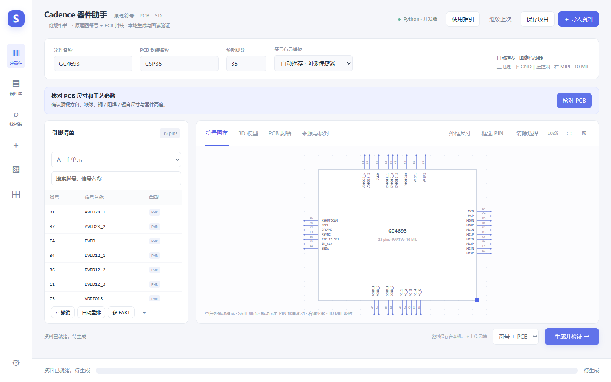
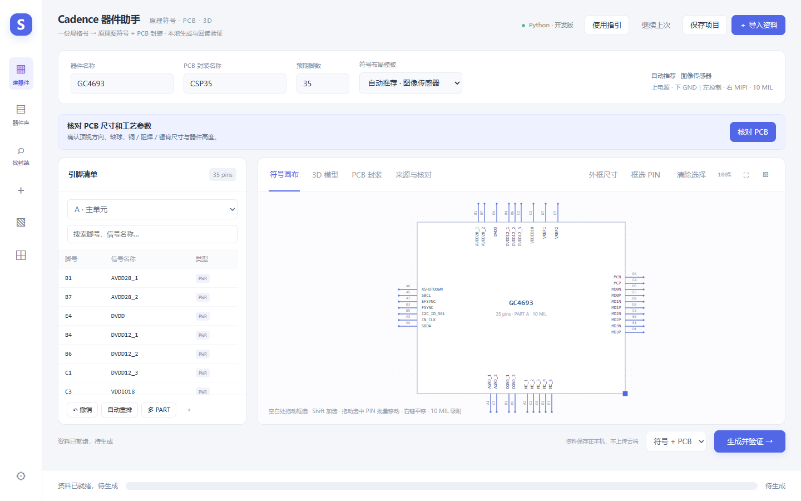
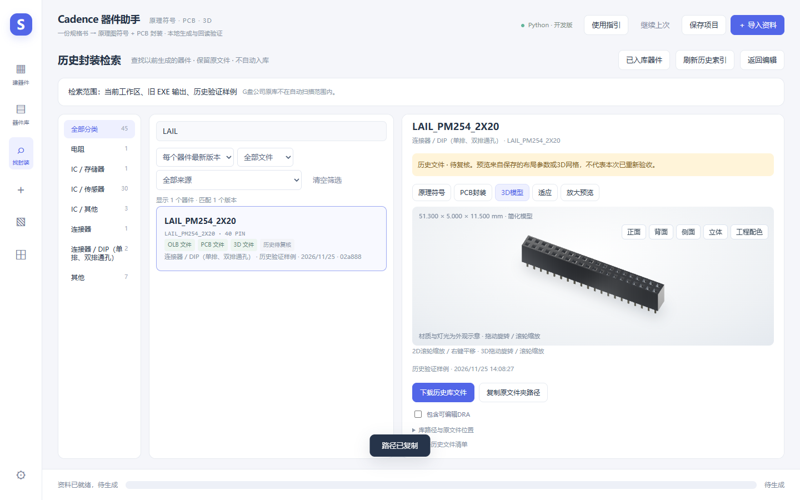

# GPT-ORCAD-SYMBLE · 器件符号与 PCB 封装助手

## 使用授权

**免费非商业使用；商业使用须事先取得作者单独书面授权。** 详见 [LICENSE](LICENSE)。

允许个人学习、教学、非商业研究，以及保留许可和署名的免费分享与修改。
企业内部研发/生产、收费项目、替客户画符号或封装、销售修改版、商业在线服务，
以及将本工具生成的结果用于商业项目，均需先取得商业授权。
商业授权请通过[仓库 Issues](https://github.com/mdc1985221/GPT-ORCAD-SYMBLE/issues)联系 `mdc1985221`，不要公开敏感业务资料。

本项目属于**源码公开、限制商用**，不是允许自由商用的开源许可证。
该声明不改变第三方依赖及材料自身的许可证，也不追溯撤销此前已合法取得的其他许可。

本地运行的 Python + HTML 工具，把规格书、引脚表与封装参数整理成可编辑的原理图符号和 PCB 封装，再调用本机 OrCAD / Allegro 生成及回读验证。目标是减少重复录入、摆放引脚和核对尺寸的工作。

**当前为预览版，重点验证 Sensor 的 CSP/BGA 场景，GC4693 是主要回归样例。不是任意规格书都能无人确认直接生成可投产封装。** 默认先生成可用布局，再请用户处理识别疑点、尺寸方向和工艺参数。

历史发布标签：**v0.2.0-preview.3**；当前 main 已更新至 **2026-11-23 源码快照**，新增功能见下方更新说明。新增原理符号手动布局、外框尺寸调整、框选批量移动，并修正旧项目光学中心迁移遗漏。

## 能做什么

| 功能 | 当前能力 |
| --- | --- |
| 资料导入 | PDF 文字层、引脚 CSV、已保存项目 JSON；保留引脚来源及待核对信息 |
| 原理图符号 | 默认电源在上、GND 在下、MIPI 在右、控制信号在左；支持手动拖动、换边、外框尺寸调整、框选批量移动和撤销；坐标按工具的 10 MIL 网格吸附 |
| 多 PART | 默认生成单 PART 布局，用户决定是否拆分；可按功能分组和手动分配 |
| 截图辅助布局 | Windows 本地 OCR 匹配已有引脚名称，先展示识别结果，再确认应用；不会凭截图自动证明引脚完整性 |
| PCB 参数与预览 | 从受支持的尺寸表提取 CSP/BGA 参数，缺失项手动补齐；支持滚轮缩放、平移和图层显示开关 |
| Allegro 封装 | 生成 DRA、PSM、独立命名 PAD；毫米单位；铜、阻焊、锡膏尺寸分别处理 |
| 机械与光学标注 | BODY/BGA/OPTICAL 中心十字及独立折线箭头；Place Bound 和器件高度；焊盘内居中脚号 |
| 联合生成 | 从同一项目生成原理图 OLB 与 PCB 库，检查符号脚号和 PCB 焊盘号集合一致 |
| 自动验证 | 独立回读原生文件，核对编号、坐标、物理单位和焊盘尺寸；包含 mm/mil 导入和旧同名 PAD 冲突场景 |
| 项目保存 | 本地自动保存、导出项目、继续上次；导入完成显示“待生成”，生成并验证成功后才显示 100% |

PCB 的 REF 线宽目前为 0.15 mm，中心十字和箭头为零线宽，默认工艺参数可以在界面调整。KiCad 文件可作为辅助交换输出，尚未完成与 Allegro 全部图文样式的一致性验收。

## 安装与启动

建议 Windows 10/11 + Python 3.13。先下载 Releases 中的源码包并解压，或使用 Git：

```powershell
git clone https://github.com/mdc1985221/GPT-ORCAD-SYMBLE.git
cd GPT-ORCAD-SYMBLE
python -m venv .venv
.\.venv\Scripts\python.exe -m pip install -r orcad-assistant/requirements.txt
.\.venv\Scripts\python.exe orcad-assistant/web_app.py
```

打开 <http://127.0.0.1:8765/>，PCB 页面为 <http://127.0.0.1:8765/#pcb>。服务窗口需保持运行。也可以在依赖安装到系统 Python 后，双击 `启动符号助手.cmd`。当前提供源码版，不提供 EXE 安装包。

原生 OLB / DRA / PSM / PAD 的生成需要已安装并可用的 **Cadence OrCAD / Allegro**。首次使用在界面环境设置中填写本机路径：

- Allegro 可执行文件，例如 `allegro.exe`；
- Capture 所需 Tcl、数据库 DLL 和工具目录；
- 可用的源符号库及器件，默认结构以 MiscLinear / LM555 为基础。

程序中的 `D:/tools/...` 是开发机器的默认示例，必须按自己的安装位置调整。没有 Cadence 时仍可导入、编辑与预览，但不能完成原生库的构建验收。仓库不包含 Cadence 软件、授权文件或用户规格书。

## 最简单的使用流程

1. 导入器件 PDF 或引脚 CSV，填写器件名、封装名和预期脚数。
2. 查看默认符号布局；需要时拆分多 PART、编辑引脚或应用截图参考布局。
3. 查看“来源与核对”，修正缺脚、重复编号、类型及识别疑点。
4. 进入“PCB 封装”，核对本体尺寸、间距、球位、顶/底视方向、中心坐标、铜焊盘及器件高度。不是所有参数都能从任意 PDF 自动取得。
5. 确认参数后选择“符号 + PCB”或“仅符号 OLB”，点击“生成并验证”。
6. 验证成功后下载结果。把库文件放入本机库路径；**已放到 PCB 上的旧封装需要 Update Symbols 或替换实例**，网页更新不会自动修改现有 PCB。

典型结果为 OLB，以及 PCB 的 DRA、PSM、PAD、预览和验证报告。生成资料及项目保存在 `orcad-assistant/workspace/`，已排除在 Git 上传范围之外。

### 手动调整原理符号

- 在“符号画布”拖动单个 PIN 调整位置或换边；拖动外框右下角蓝色方块，或点击“外框尺寸”输入宽高。
- 点击“框选 PIN”后拉框选择，或直接在空白处拉框；选中的 PIN 显示为橙色。拖动其中一个即可一起沿各自原来的框边移动，保持间距。
- Shift/Ctrl 点击加选或取消；Esc 清除选择。所有移动按网格吸附，连接点重叠或越界会整批取消；撤销一次恢复整批。
- 移动保留脚号、名称后缀、电气类型；手动位置随项目 JSON 保存。多 PART 可分别调整 PIN，当前外框宽高统一。
- “自动重排”、拆分/合并 PART、应用参考截图会重新布局；编辑后需重新生成 OLB。

详见[原理符号手动布局说明](原理符号手动布局说明.md)。此功能编辑本工具的项目，不是任意 OLB 文件导入编辑器。

PCB 参数草稿不会被后台刷新覆盖；保存项目前自动保存修改。光学中心 X/Y 可独立编辑，自定义光学中心不会强制吸附到 BGA 中心。

## GC4693 顶视方向修正

此版本修正了旧版把背视图 S1/S3 方位用于顶视图的问题。按照已核对的 p14 TOP VIEW（Bumps Down），A1 在左上：

- 本体：5.805 × 3.635 mm；阵列：5 行 × 7 列；间距：0.640 × 0.580 mm。
- 顶视图左边距 S3 = 1.04257 mm，右边距 S1 = 0.92243 mm。
- 阵列中心：**(+0.06007, −0.04465) mm**，原点为本体中心。
- 旧保存项目中匹配已知 GC4693 旧参数的记录会迁移，取消旧的生成结果并要求重新确认。自定义光学坐标不会强制覆盖。

手册 p15 负号备注与 p14 顶视图有冲突；BGA 与光学中心相同的坐标标值也与“不重合”的文字不一致。当前样例按 p14 顶视方向和所列坐标处理，设计定版前应向厂家确认。**软件回读通过只能证明文件符合输入参数，不能证明手册没有错误。**

手册焊球 Ø0.250 mm 与 PCB 铜焊盘 Ø0.200 mm 是不同对象；后者及阻焊余量是参考工艺，不是手册推荐焊盘。请按实际板厂规则确定。

## 在不同电脑修改，以及在线使用

GitHub 用于保存、共享和同步源码，不会替你运行本地 Python 或 Cadence。可以用 GitHub 网页编辑源文件，也可在各台电脑拉取更新：

```powershell
git pull --ff-only
```

更新前保存项目并停止旧服务，更新后重新启动；保留本机 `workspace/`。已有本地源码修改时先提交或整理，避免直接覆盖。项目 JSON 和规格书默认不随源码同步，可自行传递项目文件。

**计划中的在线方案**：在线界面负责项目编辑和任务管理，由安装 Cadence 的本地工作节点执行生成。任意位置使用还需要身份认证、项目同步、权限及安全连接。此版本尚未实现；GitHub Pages 也无法直接运行 Python、Tcl 或 Allegro。

## 已验证与仍需完善

已在开发机的 Windows / Cadence 环境验证 GC4693 原生构建、毫米及 mil PCB 导入、独立 PAD 加载、绘图参数和 35 个球位。修正后的 R5 球位与独立顶视 DXF 的最大坐标差为 0.00005 mm（四位毫米精度舍入）。自动化单元测试与隔离浏览器测试随版本完成；它们不代替目标工程的 DRC、网表、光学和制造审核。

preview.3 已通过 49 项单元测试、隔离浏览器交互测试，以及手动/批量调整后的单 PART、4 PART OrCAD 16.6 OLB 逐脚坐标回读。已覆盖调整外框后继续移动 PIN、框选、Shift 选择、整批撤销、项目恢复和旧项目中心坐标迁移。浏览器及原生回读属于开发机验收；源码包内提供可独立运行的单元测试。

后续重点：

- 扩大 Sensor 型号、厂商和表格结构的真实资料测试，增加明确的顶/底视方向识别及冲突提示。
- 增加 QFN、QFP、BGA、LGA 等封装的独立建模规则；目前不能宣称通用全自动支持。
- 扫描 PDF 的完整引脚 OCR、缺脚识别、截图识别准确率评估。
- 机械/光学中心分别提取，并对手册坐标、图示和注释建立一致性检查。
- 将 DXF 2000 导出与叠图核对正式集成 Web；当前 DXF 核对图属于独立验证工具。
- 补齐 KiCad 样式验证、钢网/阻焊工艺配置、尺寸公差和生产检查。
- 支持更多 Cadence 版本、安装路径和源库结构；提高首次运行的环境检测能力。
- 增加批量任务、跨设备项目同步，以及在线界面 + 本地生成节点。

## 开发与目录

```powershell
python -m pip install -r requirements-dev.txt
cd orcad-assistant
python -m unittest discover -s tests
```

| 目录 / 文件 | 用途 |
| --- | --- |
| `orcad-assistant/web_app.py`、`web/` | 本地 HTTP 服务与 HTML 界面 |
| `assistant_core.py`、`build_pipeline.py` | 项目、符号布局、原生 OLB 构建与回读 |
| `pcb_workflow.py`、`footprint_pipeline.py` | 尺寸提取、联合构建、Allegro 验证 |
| `templates/` | 符号脚本、封装生成器与必要的 DRA 种子模板；生成时清理种子几何 |
| `examples/`、`tests/` | 引脚表样例和自动化测试 |
| `workspace/` | 本机项目、资料、输出；不上传 Git |

仓库不提交用户规格书、会话备份、成品库、安装依赖和临时测试文件。使用中遇到问题，可在 Issues 中提供操作步骤、版本、脱敏参数及错误信息。

## 3D 建模与验收

[3D 模型生成与验收要点](3D模型生成与验收要点.md)：说明规格书细节、尺寸依据、PCB/STEP 坐标一致性、玻璃透明兼容、检查版 STEP、预览渲染及目标 CAD 验收要求。

## 完整建库演示

[GC5613-C43YA：规格书、原理符号、PCB 与详细 3D](examples/GC5613-C43YA/README.md)。包含已生成的 Cadence 设计文件、交互预览与验证记录；工艺预设和目标工程验收范围见案例说明。

<!-- qfn-layout-update-20261123 -->
## 2026-11-23：异形 QFN、布局模板与器件库

当前 main 的 Python/Web 源码已加入：

- **符号布局模板**：自动推荐、图像传感器、电源管理、通用 IC、按脚号排列；TPS543620 自动推荐电源管理；名称/类型不变，连接点仍为10 MIL。
- **异形 QFN 首例**：TI TPS543620 / RPY0014A；铜、阻焊和锡膏独立多边形，支持L形、SMD/NSMD混用；原生SSM/PAD/DRA/PSM生成与轮廓回读、mm/mil导入验证。
- **器件库管理**：验证后收录、分类、预览、设计文件下载与Capture/psmpath/padpath/3D路径复制。异形焊盘的SSM依赖随下载保留。
- **详细3D**：CSP/BGA感光面与玻璃细节，以及QFN独立端子模型；STEP重导入、逐实体几何核对，Web显示真实保存模型对应的网格。
- **规格书适配和修复**：GC5613的NC/双向脚、机械/光学尺寸；SC8238/OS04A10；预览缩放、重连提示与批处理退出、UTF-8记录问题。

本次96项自动回归测试和实际Web流程验证通过。测试通过不等于目标工程DRC或制造验收；新型号仍需核对资料与工艺。QFN目前仅适配已核对PDF版本，多锡膏窗口尚未开放。旧EXE/旧发布标签保留原版本，新增功能请运行main源码。

[异形 QFN 与电源管理布局演示、下载及限制](examples/TPS543620-QFN/README.md)。官方规格书通过TI链接获取，本次不上传原PDF或公司库。

安装：`pip install -r orcad-assistant/requirements.txt`；3D另装`orcad-assistant/requirements-model3d.txt`，详见[应用说明](orcad-assistant/README.md)。启动仍使用`启动符号助手.cmd`或`python orcad-assistant/web_app.py`；原生库生成需本机Cadence环境。

<!-- history-connector-update-20261125 -->
## 2026-11-25：历史封装检索与连接器规则

当前 main 新增历史封装检索：按型号、封装、分类和PIN数搜索，筛选文件类型及来源，预览原理符号/PCB/已有3D，放大查看、复制库路径及下载设计文件。入口为侧栏“历史封装检索”，也可访问本地服务的 `/#history`。历史记录保留待复核状态；预览优先读取构建快照，避免后续草稿冒充旧产物。

新增连接器无源符号、单排/双排DIP通孔分类与可复用SKILL，完成已核对12P贴片连接器适配及40P排母原生/STEP样例验证。通用新连接器的PDF识别、参数录入和Web一键PCB/3D联合生成仍需继续接入；铜/阻焊工艺预设与无尺寸外观近似需复核，不能宣称任意规格书均可直接生产。

106项单元测试及真实浏览器检索、预览、放大、导航和下载检查通过。本次为Python/Web源码更新，旧EXE未重打包，未新增规格书或公司库产物。其他电脑只会检索其本地已有历史文件。

[本次Markdown开发小结与待完善事项](开发小结-2026-11-25.md) · [规格书到器件库流程](规格书到器件库-建库与验收流程.md) · [连接器SKILL](skills/cadence-connector-library/SKILL.md)

<!-- usability-update-20261126 -->
## 2026-11-26：交互与易用性改进

- 侧栏新增文字入口，空项目首页聚焦导入、示例和查找已有封装。
- 历史记录默认按器件和封装显示最新版本，可切回全部版本；增加清空筛选、Enter打开结果、路径折叠和复制PCB两项路径。筛选后不再显示已被排除的旧预览。
- 导入后直接查看默认单PART布局，不再强制弹窗；引脚编辑、多PART操作与截图布局保存失败时保留弹窗和输入。
- 引脚方位使用上/下/左/右通用标签；PCB未保存修改在关闭或刷新时提醒。

106项单元测试及隔离浏览器操作/失败恢复检查通过。生成尺寸和10MIL规则未改变，旧EXE未重新打包。

[本轮优化小结、已修正项与后续优先级](易用性优化小结-2026-11-26.md)。

<!-- application-screenshots-20261126 -->
## 软件界面预览

以下为2026-11-26 Python/Web界面实拍；本地历史记录数量随电脑已有文件变化。截图展示操作界面，不代表图中器件已完成生产验收。

### 简洁首页



### 原理符号编辑



### 历史检索与3D预览



### 小窗口布局


<!-- mosfet-archive-20261126 -->
## 2026-11-26：规格书归档与 MOSFET 支持

- 器件库详情增加规格书归档、打开及补充上传；按厂家和型号关联，按内容哈希去重。原PDF移动后仍可从库里打开。
- 已有记录可按保存来源补齐资料；找不到的条目标记“待补规格书”，不会借用相近型号。历史库、公司库和用户PDF不会随源码自动上传。
- 支持保存和预览本次核对的NMOS/体二极管线段图形；MOSFET机械端子与PCB铜焊盘独立建模，STEP预览使用保存后重新导入的实体网格。
- 自动Allegro调用显式使用`-pcb`，避免生成、回读和导入检查反复弹出Product Choices。
- 增加[封装命名规范](器件封装命名规范.md)及[本轮验证说明](MOSFET建库及规格书归档-20261126.md)。

110项源码测试通过；本机两款MOSFET完成OLB、异形PCB及STEP独立回读，仍需目标工程与工艺验收。AON7544使用TECH PUBLIC机械页，PCB为推导的工艺候选，不能与AOS同型号资料混用。本轮属于人工核对样例及基础功能扩展，并非任意MOSFET规格书全自动解析。样例PDF、生成库和本机EXE未放入本次源码提交；现有演示文件保持不变。
