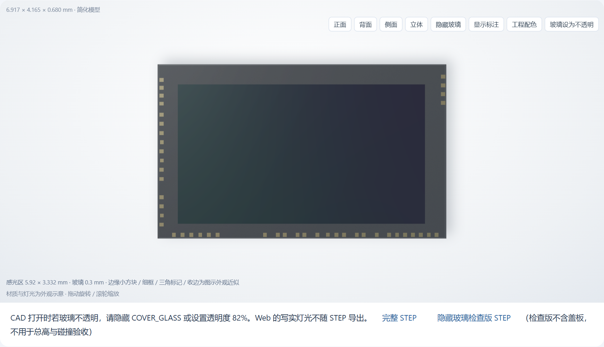
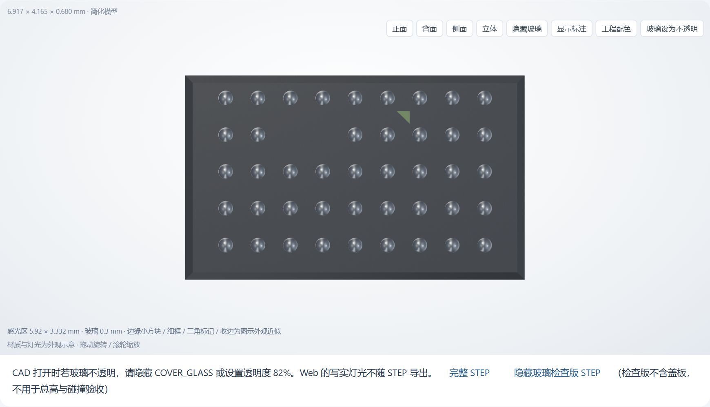

# GC5613-C43YA 完整建库演示

从同一份 GC5613-C43YA CSP V1.1 规格书生成 43 脚原理符号、Allegro PCB 封装和含感光面、玻璃、焊球及图示外观细节的 STEP。

## 快速查看和下载

- [规格书 PDF](datasheet/GC5613-C43YA-CSP-Datasheet-V1.1.pdf)
- [设计文件 ZIP](GC5613-C43YA-review-design.zip)：OLB、DRA、PSM、PAD、STEP，按 IC 分类存放。
- [生成文件目录](design-files/)
- [交互预览 HTML](preview.html)：下载本目录后打开；支持符号、PCB、3D 切换以及滚轮缩放、拖动旋转和玻璃显示切换。GitHub 的源码页面不直接运行 HTML。
- [完整 STEP](3d/GC5613_C43YA.step) / [无玻璃检查版](3d/GC5613_C43YA_INSPECTION_NO_GLASS.step)
- [验证记录](验证记录.md)
- [文件哈希](SHA256SUMS.json)

## 验证结果

85 项自动测试通过；43 脚 OLB 原生回读、Allegro PAD/PSM 的毫米及 MIL 隔离导入、94 实体 STEP 重导入和实际 Web 上传/生成/下载流程通过。仅 B6/B7 缺球；NC A5/B8 仍保留焊球。用户已确认本次演示结果。

本体 6.917 × 4.165 mm，典型总高 0.680 mm；光学中心与 BGA 中心分别按资料核对。符号维持 10 MIL 连接网格。PCB 与 STEP 使用相同球位坐标。

铜焊盘/锡膏 0.240 mm、阻焊扩展及 Courtyard 属工具工艺预设，须按实际设计和板厂能力审核；尚未完成用户目标工程的连接、DRC 及装配验收。无尺寸细节只作有来源的外观近似，详细边界见验证记录。检查版省略玻璃，不用于总高或碰撞验收。

规格书保留原始文件内容，第三方资料权利归原权利人；仓库软件许可不自动授予该资料的额外权利。本案例演示本次已生成产物，不表示远端旧版本代码已包含本地全部适配修改。
