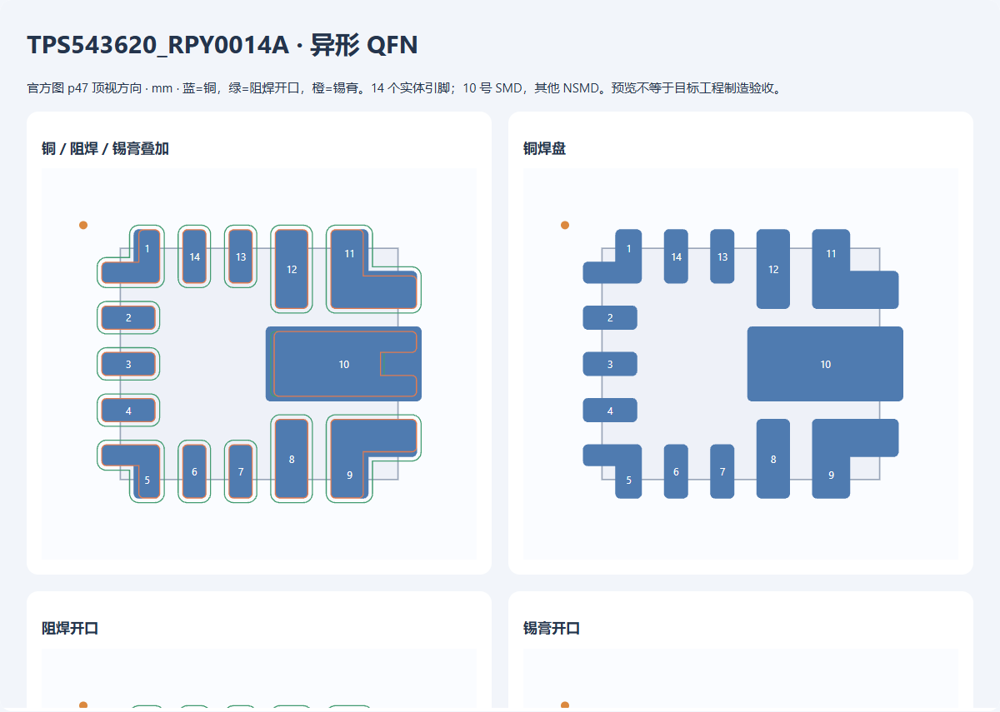
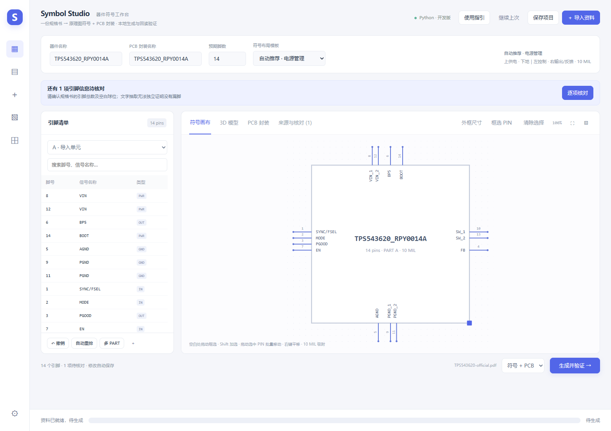

# TPS543620：异形 QFN 与布局模板演示

已核对 TI TPS543620 的 RPY0014A 封装（4225171/D）。

- [官方规格书](https://www.ti.com/lit/ds/symlink/tps543620.pdf)：引脚 p3、器件机械 p46、PCB land pattern p47、锡膏 p48。此处不重新分发原PDF。
- [设计用库](TPS543620-QFN-review-design.zip)：OLB / PSM / PAD / SSM / STEP，含可编辑 DRA；必须同时保留 SSM 轮廓依赖。
- [交互预览](preview.html)：下载本目录后用浏览器打开；GitHub 源码页不执行HTML。

## 工具新增能力

符号布局提供自动推荐、图像传感器、电源管理、通用IC、按脚号排列。TPS543620 自动推荐电源管理：上供电、下地、左控制、右SW与FB。切换不改变脚号、电气类型；连接点保持10 MIL。

异形PCB保留每脚独立铜/阻焊/锡膏多边形：10号SMD，其余NSMD；支持L形及非对称轮廓。原生生成23个SSM形状、14个PAD及DRA/PSM，下载与器件库会保留SSM，并分别提供psmpath/padpath。

3D依器件机械端子图单独建模，不能将PCB焊盘当成器件端子。共16实体，含本体、14端子及PIN1外观标记。端子圆端/角部有简化，金属厚度/站高选值及顶面标记的外观近似不代表内部引线框架的完整还原。

## 验证与边界

96项回归测试通过；原生OLB连接点、DRA多边形回读及mm/mil实际PSM导入通过；STEP重导入逐实体包络/体积通过。真实Web导入、联合生成、器件库收录、3D预览与含SSM的设计ZIP下载均已验证。联合流程中断后使用同一次真实生成文件继续验证，未替换为模拟产物。

新布局是后续Web改进，下载中的原生样例符号保留首次生成布局；可在当前工具选择电源管理后重新生成。页面截图显示新布局，不冒充原生样例的截图。

当前只自动适配已核对的这一PDF版本（SHA-256匹配），不是任意异形QFN通用识别。原生每层目前只支持一个闭合轮廓；多锡膏窗口会明确阻断，尚未实现。圆角为弦段近似。焊盘参考尺寸、阻焊扩展及工艺选择需按厂商/板厂确认。目标工程连接、DRC与制造/装配验收尚未完成。

本次更新为Python/Web源码和演示产物；旧EXE未重新打包。现有公司库不随本更新上传。
